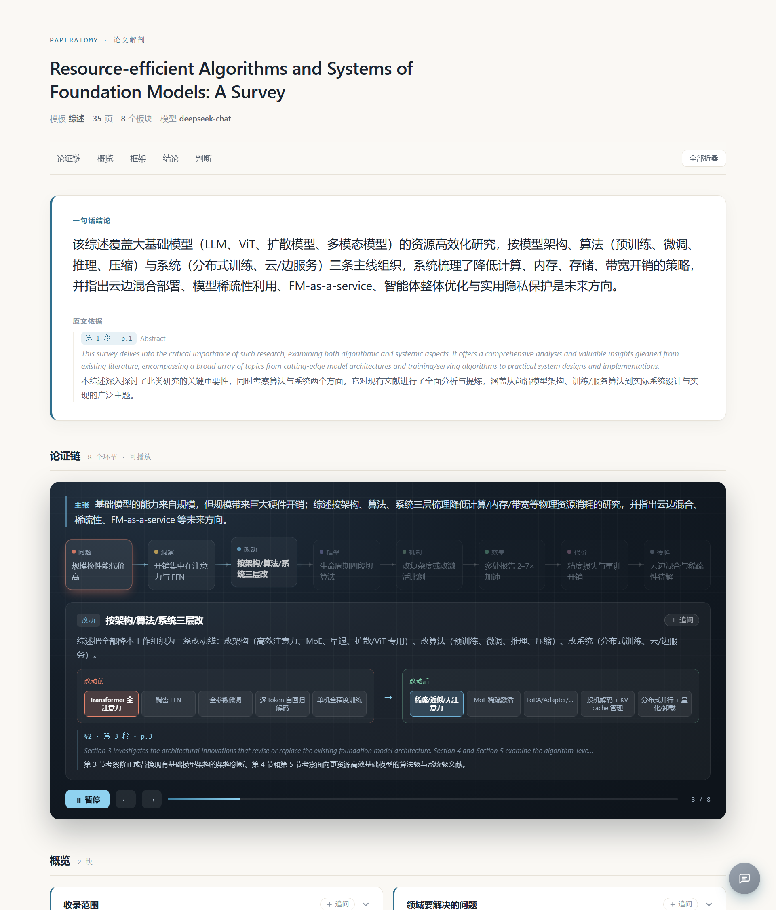
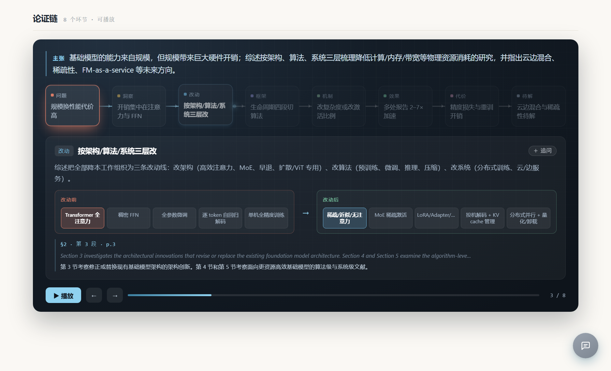

# paperatomy · 论文解剖

> 把一篇论文拆成一张结构图 —— 不是和它聊天，是让它自己交代清楚。

[](LICENSE)
[](https://www.python.org/)
[](https://github.com/1fish4/paperatomy/actions)
[](https://1fish4.github.io/paperatomy/)

**在线演示**：<https://1fish4.github.io/paperatomy/>
（同一篇 35 页综述的 `survey` 与 `skim` 两种报告，可直接点开操作）

---

## 为什么需要它

读英文论文最耗时的不是查单词，是**看完之后说不清这篇到底讲了什么**：研究问题是什么、为什么之前没人解决、方法的关键在哪、结论靠不靠得住。

现有的工具分两类，都不解决这个问题：

| 类型 | 代表 | 缺什么 |
|------|------|--------|
| **和论文聊天** | ChatPDF、SciSpace、ExplainPaper | 一问一答没有骨架，回答不带出处 —— 你不知道它说的是论文的话还是它自己编的 |
| **论文关系网络** | Connected Papers、ResearchRabbit | 给你一张相似论文的网，但不告诉你这篇本身讲了什么 |

paperatomy 走第三条路：**按固定骨架把单篇论文拆开**。

打开就是六块或十二块内容。每块都带「§章节 · 第几段 · 页码」与原文摘录（配中文译文），可以逐条核对；读完还有疑问，就在页面里直接追问。



<sub>上图：一篇 35 页 ACM 综述的 `survey` 模板产出（节选）。每块底部是原文页码与摘录。</sub>

## 与聊天式工具的四个区别

**1. 先给答案，再让你追问。** 报告先回答「读者一般会问什么」，打开即完整；
剩下的疑问在页面里直接问（见下文「追问」），不用自己组织开场白。

**2. 每句话有出处，细到段。** 每个板块都附 `§章节 · 第几段 · 页码 + 原文摘录`。
出处不是模型自报的，是程序拿引文回原文匹配出来的。

**3. 明确告诉你哪里不确定。** 低置信度打标记；**在原文里找不到原话的引文**
打「未核实」标记，而不是混在正常证据里；材料被压缩过时会写「原文省略」。
宁可标缺失，不要编。

**4. 结构可计算。** 输出是标准 JSON，不是一段散文。可以拿去做对比、做统计、做多篇汇总。

## 论证链：把这篇论文的推理演出来

文字说清「方法分三步」很啰嗦，看图三秒就懂。但「好看的流程图」到处都是，
真正缺的是**这一篇论文自己的推理线**：

> 它看到了什么问题 → 有什么关键判断 → 具体改了什么 → 通过什么机制起作用
> → 量出来什么结果 → 付出了什么代价

这条链**不是模板**：节点几个、什么类型、什么顺序，全由论文自己决定。
固定的是渲染引擎（怎么排版、怎么动、怎么标差异），不是叙事结构。



<sub>上图：一篇 35 页综述的论证链停在第 3 个环节——「注意力由二次改为线性」，
中间那栏就是它的改动前后对照（`QK^T 全对全 / Softmax / AV` → `稀疏低秩近似 / 线性或 SSM 递推`）。</sub>

| 节点类型 | 作用 |
|----------|------|
| `problem` 问题 | 论文要打的靶子，能量化就量化 |
| `insight` 洞察 | 作者的关键判断：为什么这条路可能通 |
| `change` 改动 | **必须给 before / after 图示** |
| `mechanism` 机制 | 通过什么起作用 |
| `effect` 效果 | 必须带数字 |
| `cost` 代价 | 失效条件、适用边界 |
| `taxonomy` 框架 | 分类体系（综述常用） |
| `question` 待解 | 尚未解决的问题 |

### 「改进具体体现在哪里」

这是 `change` 节点要回答的。它必须同时给 `before` 与 `after` 两份**图示规格**：

```json
"before": {"kind": "tokens", "n": 9, "cadence": 1.5, "label": "逐 token 串行"},
"after":  {"kind": "tokens", "n": 9, "cadence": 0.4, "label": "草稿 + 并行验证"}
```

`cadence` 不描述「更快」，它让更快**发生**——同一排 token，间隔 1.5 要点一秒七才亮完，
0.4 只用零点四七秒。速度差异被看见，而不只是被描述。

四种图示够用：`tokens`（逐步点亮，演速度）、`blocks`（模块对照，演结构改动）、
`bars`（指标对比）、`text`（退路）。

### 三条硬约束（写进校验，不靠自觉）

- **没有原文依据的改动不许画**：`change` / `effect` 没有页码与摘录直接判不合法
- **效果必须是数字**：`metric.value` 要能被程序读出数，不接受「显著提升」
- **抽不出来就不抽**：空链是合法结果；模型说「这篇没有可演的链」时不会逼它重编

> **实测**（35 页 ACM 综述，25 秒）：首轮抽出 12 个节点、3 处不合规，
> 修复后收敛到 8 个。链条是
> 「资源代价 → 瓶颈在注意力与 FFN → 注意力二次改线性 → 消掉 T² 项 → Mamba 提速 5×
> → 解码改为先猜后验 → 解码提速 2–3× → 精度与工程代价」。
> `change` 节点给出的对照是 `QK^T 全对全 / Softmax / AV` → `稀疏低秩近似 / 线性或 SSM 递推`，
> 这是那篇论文真实的结构改动，不是编出来的示意图。

## 快速开始

```bash
git clone https://github.com/1fish4/paperatomy.git
cd paperatomy
pip install -e ".[dev]"
```

配置模型（一次性）：

```bash
paperatomy config set --api-key sk-xxx \
  --base-url https://api.deepseek.com/v1 \
  --model deepseek-chat
```

跑一篇论文：

```bash
paperatomy extract paper.pdf -t survey -l zh -o out/paper
```

产出三个文件：

```
out/paper.json   # 结构化结果，供程序消费
out/paper.md     # Markdown，便于贴进笔记
out/paper.html   # 单文件报告，双击打开
```

**不想敲命令行？**起一个本地工作台：

```bash
paperatomy serve
```

打开的是一个上传页：把 PDF 拖进去，选模板和语言，后台自动跑完整条流水线
（约 30–60 秒），完成后点开报告直接读、直接追问。论文和 key 都不离开本机。

## 模板：换骨架不用改代码

模板是 YAML，定义「有哪些板块、每块要回答什么」。内置三套：

| 模板 | 用途 | 板块 |
|------|------|------|
| `skim` 速读 | 五分钟判断值不值得细读 | 6 块 |
| `deep` 精读 | 完整解剖，含方法步骤与实验 | 12 块 |
| `survey` 综述 | 抓住分类框架与开放问题 | 8 块 |

```bash
paperatomy templates                  # 列出全部模板
paperatomy extract p.pdf -t deep      # 换模板
```

**语言是参数，不是模板的维度**：

```bash
paperatomy extract paper.pdf -l zh      # 中文
paperatomy extract paper.pdf -l en      # 英文
paperatomy extract paper.pdf -l zh+en   # 中英并列
```

自己加一套模板（法律论文、医学病例报告），只需要往 `paperatomy/templates/` 放一个 YAML，不用改任何代码。格式见 [docs/template-format.md](docs/template-format.md)。

## 用自己的模型

不内置任何 key，不代理请求，不上传数据。支持三种配置方式：

```bash
# 1. 环境变量（推荐）
export PAPERATOMY_API_KEY=sk-...
export PAPERATOMY_BASE_URL=https://api.deepseek.com/v1
export PAPERATOMY_MODEL=deepseek-chat

# 2. 配置文件
paperatomy config set --api-key sk-...

# 3. 每次命令行传入
paperatomy extract paper.pdf --api-key sk-...
```

任何兼容 OpenAI 接口的服务都能用：DeepSeek、通义千问、Kimi、OpenAI、本地 Ollama。

## 只重新渲染，不重新花钱

改了样式或模板标题，不需要再调一次模型：

```bash
paperatomy render out/paper.json
```

它从已有 JSON 重建 Markdown 与 HTML。

**只给已有报告补一条论证链**（也不动正文，正文往往已人工核对过）：

```bash
paperatomy chain out/paper.json
paperatomy nodes                 # 看有哪些节点类型、各自要求什么
```

## 证据定位：从「p.13」到「§4.2 · 第 3 段」

只给页码是不够的——拿到 p.13 还得在一整页两栏里自己找。
让模型自报段号它又数不准：它看到的文本没有段落边界。

所以这件事由程序做：

1. `parse` 在解析时把全文切成段落，编上「章节 + 段号 + 页码」
2. 模型只负责**逐字**抄回原话
3. `locate` 拿引文回原文匹配，命中哪段就报哪段的坐标

匹配不上本身就是信息：这条引文在原文里找不到原话，多半是模型
改写而不是照抄。这样的证据打上「未核实」，不混进正常证据里。

实测一篇 35 页综述：42 条证据，40 条在原文定位成功；
未命中的那几条逐条检查，确认都是模型改写过的——定位器抓得对。

### 证据是中英对照的

英文摘录下面直接给中文译文，不用切出去查翻译。
译文由同一次抽取顺便完成，不额外调一次模型。

## 追问：在报告页面里直接问

报告回答了「一般读者会问什么」，但读者自己的疑问还是会有。
每个板块右上角有「追问」按钮，点一下把这块内容带进对话：

```bash
paperatomy serve                    # 工作台：上传 PDF 直接分析
paperatomy serve out/paper.json     # 只服务这一份报告
```

- 答案**只用这篇论文的材料**，材料里没有的它会明说「论文没提到」
- 材料是压缩过的，模型知道哪些段被省略，缺失处会建议你看原文页码，而不是猜
- key 留在本地配置里，页面只跟 `127.0.0.1` 说话；模型回答逐字流式输出
- 静态托管的那份报告没有提问功能——这是有意的：线上演示不该花别人的钱，
  报告里的证据定位与中英对照则不依赖服务，打开就有

## 调试解析（不调用模型）

```bash
paperatomy parse paper.pdf
```

输出章节划分、页数、字符数，以及被跳过的参考文献占比。**先确认解析对不对，再花钱抽取** —— 这个命令的意义就在这。

## 架构

```
PDF
 ↓  parse.py      版面解析：双栏还原、章节切分、页码保留
带页码的结构化文本
 ├─ extract.py    LLM 按模板抽取 → JSON（每块带证据）
 │   ↓  validate  校验：必填块是否齐、证据是否缺、块 id 是否编造
 │   ↓  修复循环  校验不通过 → 把具体问题回喂 → 重试（最多 2 轮）
 └─ chain.py      LLM 抽论证链 → 节点序列（含前后对照图示、数字）
     ↓  validate  空链合法；改动必须有依据；效果必须有数字
 ↓  locate.py     拿引文回原文匹配 → §章节 · 第几段 · 页码；匹配不上的标「未核实」
 ↓  render.py     报告（HTML）/ Markdown / JSON
```

**`pipeline.py` 把这条流程串成一步**，命令行与工作台（页面上传）是它的两个入口。

**两条链路共用同一次 PDF 解析，各跑一次模型。** 正文与论证链是两种不同粒度：
正文求全（八块十二块都要），论证链求准（宁可短，不许编）。

**校验与修复循环是核心，不是可选项。** 模型会漏块、会编出不存在的板块、会给不出证据、
会把十二章写成十二个节点。程序负责保证输出能被机器消费，并让模型自己把缺口补上。

## 当前进度

| 模块 | 状态 |
|------|:---:|
| PDF 版面解析（双栏 / 章节 / 页码 / 参考文献剔除） | ✅ |
| 模板加载与校验 | ✅ |
| 内置模板 `skim` / `deep` / `survey` | ✅ |
| LLM 抽取 + 校验 + 修复循环 | ✅ |
| 三种产物（JSON / Markdown / HTML 报告） | ✅ |
| **论证链抽取 + 校验（空链也合法）** | ✅ |
| **可播放演示（逐步点亮 + 前后对照 + 数字滚动）** | ✅ |
| 命令行（`templates` / `nodes` / `parse` / `extract` / `chain` / `render` / `config`） | ✅ |
| 单元测试 | ✅ 81 项 |
| 引用与相似论文网络 | ⬜ 三期 |

**实测**：一篇 35 页的 ACM 综述（*Resource-efficient Algorithms and Systems of Foundation Models*），
解析 8 个章节全部正确，压缩后 155,700 → 89,090 字符（参考文献占 38%，已剔除），
正文抽取 **23–29 秒**，8 个板块全部带页码证据；论证链抽取 **25 秒**（含一轮修复）。
单篇总成本约几分钱。

## 路线图

- **一期（已完成）**：PDF → 模板抽取 → 单文件报告
- **二期（已完成）**：论证链 —— 8 种节点类型 + 4 种图示 + 可播放前端
- **三期**：文献网络（OpenAlex 免费 / Semantic Scholar 限速）、多篇对比

关于「为什么固定渲染、不固定叙事」，见 [docs/argument-chain.md](docs/argument-chain.md)。

## 不做的事

- **不做真动画（视频级）**。把论文方法编译成可执行动画需要先把它变成程序，是研究级难题，
  且每篇论文都得重来。这里做的是「声明式参数 + 手写渲染」：动得有限，但对**任何**论文都能跑。
- **不演公式推导**。定理证明没有「改动前后」可言，`change` 无从下手，这类论文会返回空链。
- **不做跨论文对比**。一条链只属于一篇论文。
- **不做全文翻译**。翻译工具已经够多，缺的是结构——但每条英文摘录都带中文译文，核对证据时不用切出去查。
- **不转载论文内容**。只输出结构化摘要与短引用，原文留在用户本地。
- **不内置 key、不上传论文**。所有请求直连你配置的服务。

## 贡献

见 [CONTRIBUTING.md](CONTRIBUTING.md)。最欢迎的两类贡献：**新模板**（一个 YAML 就够）和**真实论文的失败案例**（哪篇抽得不好，比夸奖有用）。

## 许可

MIT，见 [LICENSE](LICENSE)。
