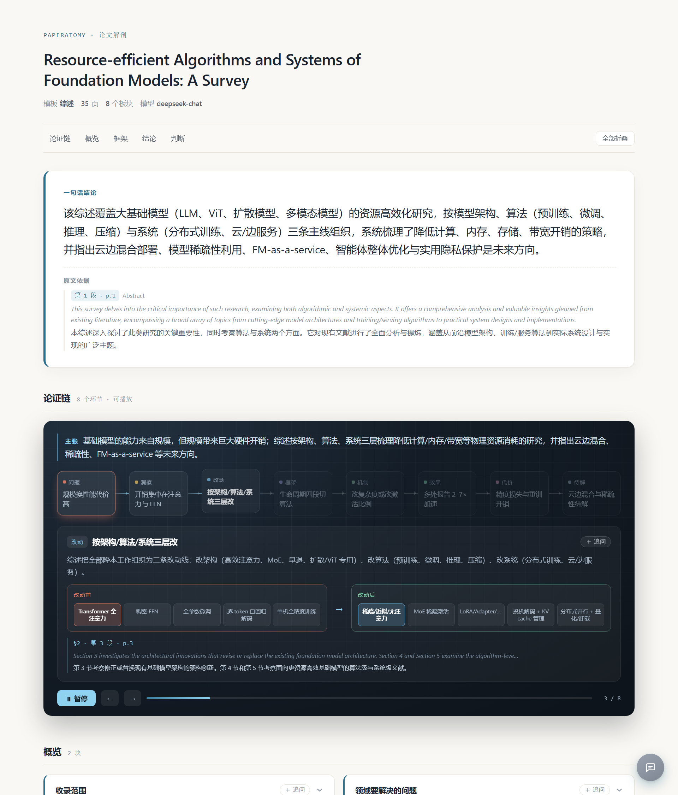
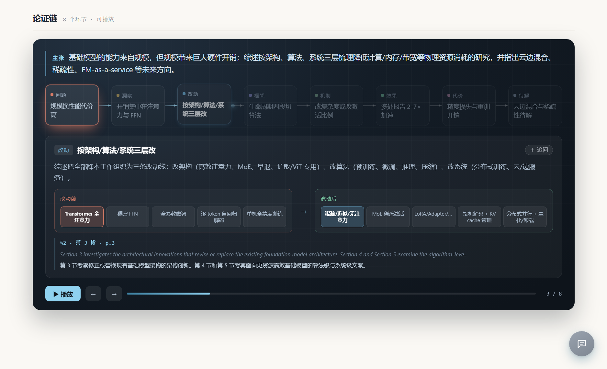

# paperatomy · 论文解剖

> 把一篇论文拆成一张结构图 —— 不是和它聊天，是让它自己交代清楚。

[](LICENSE)
[](https://www.python.org/)
[](https://github.com/1fish4/paperatomy/actions)
[](https://1fish4.github.io/paperatomy/)

**在线演示**：<https://1fish4.github.io/paperatomy/>
（同一篇 35 页综述的 `survey` 与 `skim` 两种报告，可直接点开操作）

---

## 为什么需要它

读英文论文最耗时的不是查单词，是**看完之后说不清这篇到底讲了什么**：研究问题是什么、为什么之前没人解决、方法的关键在哪、结论靠不靠得住。

现有的工具分两类，都不解决这个问题：

| 类型 | 代表 | 缺什么 |
|------|------|--------|
| **和论文聊天** | ChatPDF、SciSpace、ExplainPaper | 一问一答没有骨架，回答不带出处 —— 你不知道它说的是论文的话还是它自己编的 |
| **论文关系网络** | Connected Papers、ResearchRabbit | 给你一张相似论文的网，但不告诉你这篇本身讲了什么 |

paperatomy 走第三条路：**按固定骨架把单篇论文拆开**。

打开就是六块或十二块内容。每块都带「§章节 · 第几段 · 页码」与原文摘录（配中文译文），可以逐条核对；读完还有疑问，就在页面里直接追问。



<sub>上图：一篇 35 页 ACM 综述的 `survey` 模板产出（节选）。每块底部是原文页码与摘录。</sub>

## 与聊天式工具的四个区别

**1. 先给答案，再让你追问。** 报告先回答「读者一般会问什么」，打开即完整；
剩下的疑问在页面里直接问（见下文「追问」），不用自己组织开场白。

**2. 每句话有出处，细到段。** 每个板块都附 `§章节 · 第几段 · 页码 + 原文摘录`。
出处不是模型自报的，是程序拿引文回原文匹配出来的。

**3. 明确告诉你哪里不确定。** 低置信度打标记；**在原文里找不到原话的引文**
打「未核实」标记，而不是混在正常证据里；材料被压缩过时会写「原文省略」。
宁可标缺失，不要编。

**4. 结构可计算。** 输出是标准 JSON，不是一段散文。可以拿去做对比、做统计、做多篇汇总。

## 论证链：把这篇论文的推理演出来

文字说清「方法分三步」很啰嗦，看图三秒就懂。但「好看的流程图」到处都是，
真正缺的是**这一篇论文自己的推理线**：

> 它看到了什么问题 → 有什么关键判断 → 具体改了什么 → 通过什么机制起作用
> → 量出来什么结果 → 付出了什么代价

这条链**不是模板**：节点几个、什么类型、什么顺序，全由论文自己决定。
固定的是渲染引擎（怎么排版、怎么动、怎么标差异），不是叙事结构。



<sub>上图：一篇 35 页综述的论证链停在第 3 个环节——「注意力由二次改为线性」，
中间那栏就是它的改动前后对照（`QK^T 全对全 / Softmax / AV` → `稀疏低秩近似 / 线性或 SSM 递推`）。</sub>

| 节点类型 | 作用 |
|----------|------|
| `problem` 问题 | 论文要打的靶子，能量化就量化 |
| `insight` 洞察 | 作者的关键判断：为什么这条路可能通 |
| `change` 改动 | **必须给 before / after 图示** |
| `mechanism` 机制 | 通过什么起作用 |
| `effect` 效果 | 必须带数字 |
| `cost` 代价 | 失效条件、适用边界 |
| `taxonomy` 框架 | 分类体系（综述常用） |
| `question` 待解 | 尚未解决的问题 |

节点可以**允许分叉**：论文有多个并行贡献时，独立方向挂到主链节点的 `forks` 上各自成卡，不再硬串成「改动→效果→改动→效果」。

### 「改进具体体现在哪里」

这是 `change` 节点要回答的。它必须同时给 `before` 与 `after` 两份**图示规格**：

```json
"before": {"kind": "tokens", "n": 9, "cadence": 1.5, "label": "逐 token 串行"},
"after":  {"kind": "tokens", "n": 9, "cadence": 0.4, "label": "草稿 + 并行验证"}
```

`cadence` 不描述「更快」，它让更快**发生**——同一排 token，间隔 1.5 要点一秒七才亮完，
0.4 只用零点四七秒。速度差异被看见，而不只是被描述。

四种图示够用：`tokens`（逐步点亮，演速度）、`blocks`（模块对照，演结构改动）、
`bars`（指标对比）、`text`（退路）。

### 三条硬约束（写进校验，不靠自觉）

- **没有原文依据的改动不许画**：`change` / `effect` 没有页码与摘录直接判不合法
- **效果必须是数字**：`metric.value` 要能被程序读出数，不接受「显著提升」
- **抽不出来就不抽**：空链是合法结果；模型说「这篇没有可演的链」时不会逼它重编

> **实测**（35 页 ACM 综述，25 秒）：首轮抽出 12 个节点、3 处不合规，
> 修复后收敛到 8 个。链条是
> 「资源代价 → 瓶颈在注意力与 FFN → 注意力二次改线性 → 消掉 T² 项 → Mamba 提速 5×
> → 解码改为先猜后验 → 解码提速 2–3× → 精度与工程代价」。
> `change` 节点给出的对照是 `QK^T 全对全 / Softmax / AV` → `稀疏低秩近似 / 线性或 SSM 递推`，
> 这是那篇论文真实的结构改动，不是编出来的示意图。

## 全文对照翻译

在工作台打开已分析的报告，点 **全文对照翻译 → 开始全文翻译**。左侧显示原 PDF 页，右侧显示该页的简体中文译文，也可以展开原页的可复制文字。页面按原页码逐页保存，切换页面可查看已完成的译文。中断后点击 **继续翻译**，已处理的页会复用。

翻译使用当前启用的模型，会将可提取的文字发给对应服务商。原图继续保留在 PDF 原页。扫描图像及图中没有文字层的内容需要先做 OCR；翻译不会重排 PDF。

## 证据笔记

在报告的「原文依据」点 **收藏证据**，即可保存一份摘录、已有中文译文、原页位置和核实状态。点 **编辑笔记** 可以填研究主题和自己的批注。工作台首页的 **证据笔记** 可以按主题和关键词查看不同论文的笔记，并返回报告或原页。笔记保存在本地报告数据库，收藏和编辑均不调用模型。

## 快速开始

### 同学互评

1. **Windows**：安装 Python 3.10 或以上，下载并解压项目，双击 `启动工作台.cmd`。第一次启动会在项目下创建 `.venv` 并安装依赖，需要网络。若浏览器未自动打开，在启动窗口复制实际地址访问。
2. **macOS / Linux**：在解压后的项目目录运行 `python3 -m venv .venv`、`.venv/bin/python -m pip install .`、`.venv/bin/python -m paperatomy.cli serve --open`。
3. 打开工作台后，可以点 **打开免 Key 示例** 阅读已有报告和论证链。若要分析自己的 PDF，在 **模型设置** 新建并命名一份配置，填写基础地址、模型名称和 API Key，然后点 **测试并启用**。切换时选择已保存的配置并留空 Key，连接测试通过后启用。旧版本保存的单份配置会作为「默认配置」保留。本机 Ollama 可使用 `http://127.0.0.1:11434/v1`，模型名称请填本机已下载的模型。
4. 拖入可选中文字的 PDF，确认推荐模板后开始分析。完成后打开报告，选择一条有依据的结论并查看原文。使用云模型时，分析所需的论文摘录会发给你选择的服务商。

| 遇到的问题 | 处理方法 |
|---|---|
| 双击后提示找不到 Python、版本太低 | 安装 Python 3.10 或以上，确保 `py -3 --version` 或 `python --version` 可用，再双击。 |
| 依赖安装失败 | 检查网络能否访问 Python 包源。在项目目录手动运行 `python -m venv .venv` 和 `.venv\Scripts\python.exe -m pip install .`，看具体错误。 |
| 浏览器没打开或默认端口被占用 | 保持启动窗口运行，使用窗口打印的实际地址。需要指定端口时，启动命令加 `--port 8780`。 |
| 模型返回 401 / 403 / 404 / 429 | 分别检查 Key、模型权限、基础地址与模型名、额度或限流。修改后重新点「测试并启用」。 |
| PDF 已加密或没有文字层 | 换用解密后的文字版 PDF，扫描件可先用 OCR 生成文字层。 |
| 分析中断、报告未生成 | 重启后打开「诊断与修复」，在待分析论文下重新开跑。报告数据仍在时也可以重建页面。 |

命令行安装与使用如下。

```bash
git clone https://github.com/1fish4/paperatomy.git
cd paperatomy
pip install -e ".[dev]"
```

配置模型（一次性）：

```bash
paperatomy config set --api-key sk-xxx \
  --base-url https://api.deepseek.com/v1 \
  --model deepseek-chat
```

跑一篇论文：

```bash
paperatomy extract paper.pdf -t survey -l zh -o out/paper
```

产出三个文件：

```
out/paper.json   # 结构化结果，供程序消费
out/paper.md     # Markdown，便于贴进笔记
out/paper.html   # 单文件报告，双击打开
```

**不想敲命令行？**起一个本地工作台：

```bash
paperatomy serve
```

打开的是一个上传页：把 PDF 拖进去（支持一次多篇，排队逐篇分析），
后台自动跑完整条流水线，完成后点开报告直接读、直接追问。论文和 key 都不离开本机。

工作台还是个**文献库**：报告卡片带论文首页封面，可星标收藏、按模板/关键词/合集筛选；
右上角「诊断与修复」一键体检所有报告（页面完整性、缓存、待处理的 PDF），
误删进回收站可恢复，日志落盘、任务中断可续——按一个可靠本地软件的标准做的。

## 模板：换骨架不用改代码

模板是 YAML，定义「有哪些板块、每块要回答什么」。内置三套：

| 模板 | 用途 | 板块 |
|------|------|------|
| `skim` 速读 | 五分钟判断值不值得细读 | 6 块 |
| `deep` 精读 | 完整解剖，含方法步骤与实验 | 12 块 |
| `survey` 综述 | 抓住分类框架与开放问题 | 8 块 |

```bash
paperatomy templates                  # 列出全部模板
paperatomy extract p.pdf -t deep      # 换模板
```

**语言是参数，不是模板的维度**：

```bash
paperatomy extract paper.pdf -l zh      # 中文
paperatomy extract paper.pdf -l en      # 英文
paperatomy extract paper.pdf -l zh+en   # 中英并列
```

自己加一套模板（法律论文、医学病例报告），只需要往 `paperatomy/templates/` 放一个 YAML，不用改任何代码。格式见 [docs/template-format.md](docs/template-format.md)。

## 用自己的模型

不内置任何 key，不代理请求，不上传数据。支持三种配置方式：

```bash
# 1. 环境变量（推荐）
export PAPERATOMY_API_KEY=sk-...
export PAPERATOMY_BASE_URL=https://api.deepseek.com/v1
export PAPERATOMY_MODEL=deepseek-chat

# 2. 配置文件
paperatomy config set --api-key sk-...

# 3. 每次命令行传入
paperatomy extract paper.pdf --api-key sk-...
```

任何兼容 OpenAI 接口的服务都能用：DeepSeek、通义千问、Kimi、OpenAI、本地 Ollama。

## 只重新渲染，不重新花钱

改了样式或模板标题，不需要再调一次模型：

```bash
paperatomy render out/paper.json
```

它从已有 JSON 重建 Markdown 与 HTML。

**只给已有报告补一条论证链**（也不动正文，正文往往已人工核对过）：

```bash
paperatomy chain out/paper.json
paperatomy nodes                 # 看有哪些节点类型、各自要求什么
```

## 证据定位：从「p.13」到「§4.2 · 第 3 段」

只给页码是不够的——拿到 p.13 还得在一整页两栏里自己找。
让模型自报段号它又数不准：它看到的文本没有段落边界。

所以这件事由程序做：

1. `parse` 在解析时把全文切成段落，编上「章节 + 段号 + 页码」
2. 模型只负责**逐字**抄回原话
3. `locate` 拿引文回原文匹配，命中哪段就报哪段的坐标

匹配不上本身就是信息：这条引文在原文里找不到原话，多半是模型
改写而不是照抄。这样的证据打上「未核实」，不混进正常证据里。

实测一篇 35 页综述：42 条证据，40 条在原文定位成功；
未命中的那几条逐条检查，确认都是模型改写过的——定位器抓得对。

### 证据是中英对照的

英文摘录下面直接给中文译文，不用切出去查翻译。
译文由同一次抽取顺便完成，不额外调一次模型。

## 追问：在报告页面里直接问

报告回答了「一般读者会问什么」，但读者自己的疑问还是会有。
每个板块右上角有「追问」按钮，点一下把这块内容带进对话：

```bash
paperatomy serve                    # 工作台：上传 PDF 直接分析
paperatomy serve out/paper.json     # 只服务这一份报告
```

- 答案**只用这篇论文的材料**，材料里没有的它会明说「论文没提到」
- 材料是压缩过的，模型知道哪些段被省略，缺失处会建议你看原文页码，而不是猜
- key 留在本地配置里，页面只跟 `127.0.0.1` 说话；模型回答逐字流式输出
- 静态托管的那份报告没有提问功能——这是有意的：线上演示不该花别人的钱，
  报告里的证据定位与中英对照则不依赖服务，打开就有

## 调试解析（不调用模型）

```bash
paperatomy parse paper.pdf
```

输出章节划分、页数、字符数，以及被跳过的参考文献占比。**先确认解析对不对，再花钱抽取** —— 这个命令的意义就在这。

## 架构

```
PDF
 ↓  parse.py      版面解析：双栏还原、章节切分、页码保留
带页码的结构化文本
 ├─ extract.py    LLM 按模板抽取 → JSON（每块带证据）
 │   ↓  validate  校验：必填块是否齐、证据是否缺、块 id 是否编造
 │   ↓  修复循环  校验不通过 → 把具体问题回喂 → 重试（最多 2 轮）
 └─ chain.py      LLM 抽论证链 → 节点序列（含前后对照图示、数字）
     ↓  validate  空链合法；改动必须有依据；效果必须有数字
 ↓  locate.py     拿引文回原文匹配 → §章节 · 第几段 · 页码；匹配不上的标「未核实」
 ↓  render.py     报告（HTML）/ Markdown / JSON
```

**`pipeline.py` 把这条流程串成一步**，命令行与工作台（页面上传）是它的两个入口。

**两条链路共用同一次 PDF 解析，各跑一次模型。** 正文与论证链是两种不同粒度：
正文求全（八块十二块都要），论证链求准（宁可短，不许编）。

**校验与修复循环是核心，不是可选项。** 模型会漏块、会编出不存在的板块、会给不出证据、
会把十二章写成十二个节点。程序负责保证输出能被机器消费，并让模型自己把缺口补上。

## 当前进度

| 模块 | 状态 |
|------|:---:|
| PDF 版面解析（双栏 / 章节 / 页码 / 参考文献剔除） | ✅ |
| 模板加载与校验 | ✅ |
| 内置模板 `skim` / `deep` / `survey` | ✅ |
| LLM 抽取 + 校验 + 修复循环 | ✅ |
| 三种产物（JSON / Markdown / HTML 报告） | ✅ |
| **论证链抽取 + 校验（空链也合法）** | ✅ |
| **可播放演示（逐步点亮 + 前后对照 + 数字滚动）** | ✅ |
| 命令行（`templates` / `nodes` / `parse` / `extract` / `chain` / `render` / `config`） | ✅ |
| 单元测试 | ✅ 173 项 |
| 引用与相似论文网络（OpenAlex，节点 100% 可验证） | ✅ |
| **工作台**（上传 / 文库封面 / 合集 / 批量分析 / 诊断与修复 / 回收站） | ✅ |
| **多篇对比分析**（模型综合对比 + 逐板块对齐） | ✅ |

**实测**：一篇 35 页的 ACM 综述（*Resource-efficient Algorithms and Systems of Foundation Models*），
解析 8 个章节全部正确，压缩后 155,700 → 89,090 字符（参考文献占 38%，已剔除），
正文抽取 **23–29 秒**，8 个板块全部带页码证据；论证链抽取 **25 秒**（含一轮修复）。
单篇总成本约几分钱。

## 路线图

- **一期（已完成）**：PDF → 模板抽取 → 单文件报告
- **二期（已完成）**：论证链 —— 8 种节点类型 + 4 种图示 + 可播放前端
- **三期（已完成）**：文献网络、多篇对比、工作台文献库
- **四期（已完成）**：全文对照翻译、可命名模型配置与作者代码评估
- **下一步**：把证据笔记接到带引用的主题综述

关于「为什么固定渲染、不固定叙事」，见 [docs/argument-chain.md](docs/argument-chain.md)。

## 不做的事

- **不演公式推导**。定理证明没有「改动前后」可言，`change` 无从下手，这类论文会返回空链。
- **不替代精读**。所有产物都是导读与核对工具，原文永远留在你本地。
- **不转载论文内容**。静态在线示例展示结构化报告与短引用，用户的原文和全文译文保存在本机工作目录。
- **使用自己的 Key**。模型调用直接发给所配置的服务，分析和翻译会发送所需的原文文字。

## 文献网络：引用关系全部来自真实数据

在工作台分析论文后，主报告生成即可打开。文献网络会自动在后台排队匹配，报告页显示进度并在完成后更新该板块。关闭浏览器不影响本地任务；若中途关闭工作台，重新启动会继续补充仍待匹配的报告。匹配失败时可在报告页点 **重试补充**。

选中有 OpenAlex 标识的节点，点 **以此篇继续找**，可看到它引用的论文、后续引用和与它共享参考文献的相似候选。点标题展开摘要，继续扩展或加入现有合集的待读列表。需要提高请求额度时，可在启动终端设置 `OPENALEX_API_KEY`。

报告末尾有一张以本文为中心的引用网络：左叶是它引用的文献（过去），
右叶是引用它的（未来）。节点大小是被引影响力，颜色是与本文的相关度，
点击任意节点能看到年份、发表场所、DOI、领域词条（OpenAlex 标注，
field/subfield 附中文）与相关度依据。

图的上方是**本文速览**：发表场所与 CCF 等级（收录后才有）、研究领域、
以及一排**检索关键词**——点一下即复制，拿去学术搜索就能找到同方向工作。
不做"推荐文章"：新论文往往还没被索引，推荐率注定可怜；
真实的关键词比凑数的推荐诚实得多。

**节点 100% 存在的保证方式，不是"让模型别说谎"，而是让模型根本没有机会编**：
节点与关键词只来自两个可验证的来源——PDF 里印刷的参考文献列表与正文
词频统计，和 OpenAlex（2.5 亿篇真实文献的开放索引）的 API 响应。
相关度是计算值（共引与关键词重合），每个分数带可解释依据；
CCF 等级来自内置的真实目录，只标注本文自身，不给参考文献排等级。
生成时抓取并嵌入报告，离线可看。

```bash
paperatomy network out/paper.json     # 不调用模型，联网补文献网络
```

## 对比、综述与导出

在工作台点 **写文献综述**，选择 2–12 篇已分析的论文，填写研究问题后生成综述草稿。也可以从报告库的多选栏或方法对比页带着所选论文进入。草稿按主题组织，展开段落下的证据可以核对摘录和原文页，未使用或缺少已核实证据的论文会标出。**导出 Markdown** 会保留段落引用和证据页码。

### 方法工作台与作者代码

在本地工作台点 **方法对比与复现**，选择一份已分析报告就能阅读方法材料，或选择两篇查看决策步骤、约束和实验设置。**生成 AI 方法对比**会继续归纳两篇方法在哪些条件下可能作出不同决策。方法字段不足时，可以先用精读模板生成报告。

选两到四篇后，可在 **按问题比较结论** 输入具体问题。表格按结论、实验条件、指标和基线展开，证据直接引用报告中已经定位到原文的摘录。证据缺失或口径未对齐会明确标出。


在单篇报告点 **方法与作者代码**，或在方法工作台打开 **作者代码与复现**。点击 **检查论文链接**，Paperatomy 从 PDF 的文本和超链接查找 GitHub、Gitee、GitLab 仓库，并请求公开元数据检查可访问性、当前提交、许可证和 README 的复现线索。没有找到明确的代码链接时，可以点 **搜索其他代码候选**，将论文标题发送给 GitHub。匹配结果需要核对作者归属。公开仓库标记表示可以访问，复现评估标记表示已读到的文档线索。平台限流时工作台尝试用匿名 Git 接口确认访问状态和提交，README 等信息可稍后再查。

**多篇对比**——圈选 2~4 篇同领域报告，先给**模型综合分析**：共同关注的问题与共识、
一张多维度对比表（方法路线 / 实验设置 / 核心结论 / 适用场景，每篇一列）、
给读者的选读建议；底部再附逐板块对齐表（各篇同一板块说了什么，「仅一篇有」的会标注）：

```bash
paperatomy compare out/a.json out/b.json    # 生成对比页（工作台里圈选更方便）
```

**综述导出**——写论文"相关工作"章节的底稿：多篇报告合成一份 Markdown
草稿，一篇一节（速读 + 逐板块要点 + 证据位置 + 论证链一行摘要），
末尾汇总共现的检索关键词。程序合成，零模型调用：

```bash
paperatomy review out/a.json out/b.json out/c.json   # 生成 文献综述草稿.md
```

**导出打印**——报告页右下角的 ⌨ 按钮调起打印，存成 PDF：
追问面板、悬浮按钮自动隐去，板块不跨页断开。

**追问历史**——页面里的每次追问都会存进报告 JSON（问题、回答、时间），
换次打开还在；静态打开报告也能回看历史，只是不能继续问。

## 贡献

见 [CONTRIBUTING.md](CONTRIBUTING.md)。最欢迎的两类贡献：**新模板**（一个 YAML 就够）和**真实论文的失败案例**（哪篇抽得不好，比夸奖有用）。

## 许可

MIT，见 [LICENSE](LICENSE)。
